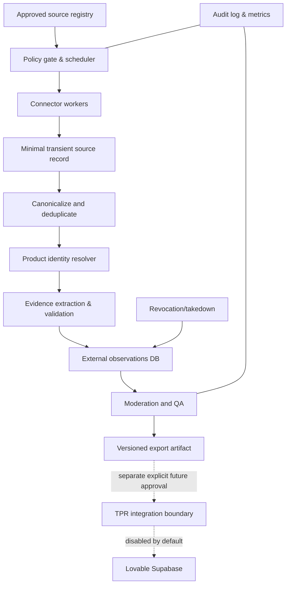

# The Players' Room (TPR)

## Technical Audit & Content Ingestion Architecture — Codex-ready specification

**Date:** October 17, 2026  
**Status:** Architecture/design specification, not deployed or implemented  
**Boundary:** Standalone external service/repository; Lovable and live TPR database must remain unchanged.  
**Project:** Lovable `c7736b82-13bd-4687-a645-a86e46e0767b`; inspected commit `ef1cbf22890973342413118738ef1c391b0513a8`.

## 1. Executive decision

Build a policy-aware, modular content-discovery and evidence-extraction service that creates **reviewable, traceable external observations**, not automatically published player ratings. Maintain independent local storage, isolated worker processes and a staged export pathway. Do NOT connect a production writer to TPR during initial phases. The fundamental constraint is that an external positive/negative claim cannot be converted into a 1–5 rating or a verified player identity without evidence. Optimize for **credible insight** rather than content volume.

## 2. Observed system (read-only audit)

Read-only inspection used Lovable get_project, list_files, read_file, get_database_status, and SELECT-only database queries. No changes were made to the Lovable project or database.

### 2.1 Verified live inventory

| Item                   | Observed result                                                                                                                        | Implication                                                                      |
| ---------------------- | -------------------------------------------------------------------------------------------------------------------------------------- | -------------------------------------------------------------------------------- |
| Stack                  | TanStack Start, TypeScript, React, Tailwind, Supabase/PostgreSQL                                                                       | Keep web app separate; integrate by a future narrow contract                     |
| Public database tables | 13                                                                                                                                     | Mature starting schema; ingest service may model concepts independently          |
| Products               | 100 rows, of which 16 marked sample                                                                                                    | Existing catalog needs stable ID matching and alias layer                        |
| Player signals         | 629 rows, all marked sample                                                                                                            | No verified live external evidence base yet                                      |
| Product categories     | Clubs, Tech, Bags & Balls                                                                                                              | Connector/catalog mapping must use current values                                |
| Product types          | driver, fairway-wood, hybrid, iron, wedge, putter, launch-monitor, rangefinder, golf-watch, golf-ball, stand-bag, cart-bag, travel-bag | Type validator must reflect current catalog                                      |
| Admin import           | Product/signals CSV via `/admin/import`                                                                                                | Usable as a human-mediated migration/bridge, not a safe automated ratings ingest |
| Score gating           | 25 approved player signals via `min_signals()`                                                                                         | Unreviewed evidence cannot count                                                 |
| Database-backed scores | `product_scores`, `product_metric_scores`                                                                                              | Do not recalculate scores in web components                                      |

### 2.2 Relevant code inspected

- `src/lib/catalog.ts` — canonical categories/types.
- `src/lib/import-rules.ts` — strict CSV validation, product matching by **existing slug**, signal fields and dedupe key.
- `src/lib/import.functions.ts` — admin authorization; preview/commit, product update, signal RPC import.
- `src/routes/admin.import.tsx` — CSV workflow and sample cleanup.
- `src/lib/ratings.functions.ts` — verified member submissions, Turnstile and rate-limit hooks.
- `src/lib/data/gear.functions.ts` — read-only data layer, consumption of aggregated scoring views.
- `drizzle/migrations/0000_create_tpr_core_tables.sql`, `0001_product_scores_view.sql`, `0011_metric_scores.sql`, `0019_unique_imported_signals.sql`, `0020_preserve_gated_score_reads.sql`.
- `roadmap.md`, `package.json`, Lovable project knowledge.

**Historical migration caveat:** `0001` is the original scoring view and was subsequently changed. Treat **current database views and current typed client** as authoritative before a future integration. The report does not claim the original migration fully describes today's score SQL.

### 2.3 Confirmed import behavior and risks

`SIGNAL_COLUMNS` currently requires: `slug, player_type, rating, would_recommend, worth_the_price, source, source_url, observed_at`. `rating` must be whole 1–5; `player_type` must be one of five buckets; `source_url` must be HTTPS; product `slug` must already exist. Batch limit 5,000 rows / 2 MB. `insert_imported_signals` writes `source_type='imported'`, `status='approved'`, `is_sample=false` and deduplicates by `(product_id, source_url, observed_at)`.

**Risk 1: approval bypass for machine-extracted evidence.** The importer approves signals on ingestion. It was designed for curated admin CSV data, not unreviewed AI content.

**Risk 2: fabricated structured fields.** Externally derived sentiment generally does not provide explicit 1–5 rating, player type, would-recommend or worth-the-price answers. Filling these with inferred values would corrupt consensus.

**Risk 3: insufficient event-level deduplication.** URL+timestamp+product is suitable for many manually curated entries, but not for multiple distinct opinions in the same forum thread or syndication across domains; conversely changing timestamps may count the same opinion repeatedly.

**Risk 4: catalog ambiguity.** A slug table alone cannot distinguish product generations, lofts, model numbers or different G440 variants in colloquial mentions.

**Risk 5: provenance/retraction.** Existing signal rows retain basic source link but do not model review decisions, changing rights, takedown requests, extraction versions and source item lifecycle.

**Security note:** Historical migrations are not a complete security audit. Read-only inspection suggests RLS, administrative import checks, restricted RPC access and privacy hardening, but do not claim a penetration test or production verification.

## 3. Goals, explicit non-goals and success definition

### Goals

1. Independently discover new, relevant golf gear content from **approved** sources.
2. Validate permitted access/use per source and preserve linked provenance.
3. Normalize source items; identify products, variants, categories and player experience claims.
4. Extract _specific_ topics (forgiveness, sound, durability, dispersion, price/value, etc.) without inventing data.
5. Deduplicate syndication, crossposts, revisits and near-identical claims.
6. Run human moderation for ambiguous/valuable observations; capture corrections/takedowns.
7. Export approved observation records and a **separate explicit-rating-only** candidate stream for future approved integration.
8. Keep all production writes disabled until separate acceptance and authorization.

### Non-goals for V1

- Republishing third-party reviews, full text, transcripts, images or user profiles.
- Web-scale indiscriminate crawling or bypassing controls.
- Claiming API permission implies permission to commercially analyze all returned content.
- Automatically seeding the TPR Consensus Score with AI-estimated ratings.
- Changing Lovable tables, views, components, frontend or production admin settings.
- Building an unapproved Reddit scraper or transcript downloader.

### MVP success targets (engineering acceptance targets, not measured results)

- 5–10 **fixture** catalog products; 3 fixture source types, 100+ test records.
- Deterministic idempotent reprocessing: 0 duplicate published observation IDs across three identical runs.
- Staging and approval workflows operational, with reason codes and audit history.
- No production network/API calls on default dev/test run.
- 100% tests passing; fixture-based product match precision ≥95% on a curated 100-case evaluation set, with unresolved items abstaining.
- Extraction requires supporting structured-source fields or licensed evidence; no inferred stars or invented handicap under adversarial tests.
- Failed jobs retry with bounded backoff; dead-letter visible; revocation excludes records from exports.

## 4. Reference architecture



**Deployable modules** (monorepo allowed within the NEW service repository): `packages/contracts`, `packages/core`, `packages/connectors`, `apps/worker`, `apps/admin` (internal, localhost/private authentication), `apps/api` (internal read/export). The ingestion service owns its own database and state.

### Data flow and gating

1. A source starts `disabled`, no permissions assumed.
2. Operator records policy decision, allowed content class, retention, quotas, attribution and permission evidence.
3. Scheduler checks enablement, rights, rate budgets and robots where applicable before network request.
4. Adapter fetches minimal metadata/content allowed for analysis; sensitive/full raw text is ephemeral only if permitted.
5. Normalize URL, external IDs, publication time, canonical item identity and SHA-256/deterministic hash.
6. Catalog resolver computes exact/model-number/alias match; low-confidence variants are held for review.
7. Extract evidence dimensions with deterministic structured fields first; optional LLM where permitted, schemas enforced.
8. Rule engine rejects duplicate, syndicated, incentivized, retailer/manufacturer, third-person and low-quality claims as independent player evidence.
9. Write observation in staging with extraction model/prompt version, reviewer status and evidence basis.
10. Review/approve/reject; exports carry source, rights state, timestamp, provenance and justification.
11. A **future**, independently authorized integration could consume approved observations, while only trustworthy native/external explicit-rating items are eligible for ratings import.

## 5. Source strategy, rights and discovery

**Priority:** TPR member submissions (first-party), licensed/permissioned data, official product specifications, permitted RSS/API metadata. YouTube Data API may support permitted video discovery/metadata; it does **not** automatically permit retrieving or repurposing all transcripts/comments for a commercial consensus system. Reddit commercial use requires careful current-term review and likely explicit permission; do not assume API approval. For web forums, legal and technical permission must be assessed domain by domain, and public accessibility is not a blanket grant to collect/reuse personal content.

Source classes:

| Source class            | Initial treatment                                | Evidence use                                                                         |
| ----------------------- | ------------------------------------------------ | ------------------------------------------------------------------------------------ |
| TPR first-party ratings | Already part of main product                     | Remain in Lovable; future analytic aggregates only through permitted interface       |
| Manufacturer pages      | Approved API/feed or permitted facts             | Official specifications, **not** player sentiment                                    |
| YouTube metadata        | Official Data API within terms and quotas        | Discovery and editorial linking; review text only where separately authorized        |
| Golf publications/blogs | Licensed feeds or explicit permission            | Label as expert/editorial; do not multiply a single article into many player reports |
| Independent forums      | Explicit source permissions and retention review | First-hand reports only after provenance/dedup checks                                |
| Reddit                  | Disabled pending terms and commercial approval   | No unauthorized scraping fallback                                                    |
| Retailer reviews        | Terms/license dependent                          | Exclude if provenance/access is not clearly granted                                  |

**Compliance control:** Each connector includes an immutable policy version ID and `enabled=false` until human activation. Fields include permitted discovery, metadata, analysis, excerpts, retention, rate limits, user-agent, robots check, takedown and source owner. Keep a per-domain policy ledger; preserve legal review as a required release gate. Route source removal to a tombstone process and exclude revoked data from future exports and caches. Minimize personal data; avoid storing author handles unless strictly justified and authorized.

**Suggested references for policy review (verify current terms on activation):** https://developers.google.com/youtube/v3 ; https://developers.google.com/youtube/terms/api-services-terms-of-service ; https://redditinc.com/policies/data-api-terms ; https://www.rfc-editor.org/rfc/rfc9309 . These are references to review, not a legal permission determination.

## 6. Domain model / proposed isolated schema

Create these tables **only in the new service's own database**:

| Table              | Key fields and constraints                                                                                                                                                                                                                       |
| ------------------ | ------------------------------------------------------------------------------------------------------------------------------------------------------------------------------------------------------------------------------------------------ |
| `source_policies`  | policy_id PK, domain/source_id, status, allowed_operations JSONB, permission_reference, reviewed_by, reviewed_at, retention, version, disabled_reason                                                                                            |
| `sources`          | source_id PK, name, type, enabled (default false), policy_id FK, schedule, rate_budget, last_success_at                                                                                                                                          |
| `crawl_jobs`       | job_id PK, source_id, external_cursor, queued_at, started_at, state, attempts, next_retry_at, error_code, run_id                                                                                                                                 |
| `source_items`     | item_id PK, source_id, external_id, canonical_url, published_at, last_seen_at, content_hash, rights_policy_id; unique(source_id,external_id); minimal retained text by policy                                                                    |
| `catalog_products` | tpr_product_id UUID (nullable for fixtures), slug, brand, name, model_number, category, type, catalog_snapshot_version                                                                                                                           |
| `product_aliases`  | alias_id, canonical_product_id, normalized_alias, variant qualifiers, origin, uniqueness rules                                                                                                                                                   |
| `observations`     | observation_id PK, item_id FK, product_id FK nullable, kind, topic, sentiment, explicit_rating JSONB nullable, player_type nullable, first_hand_basis, review_status, confidence, model/prompt version, rights_policy_id, independence_group_key |
| `review_events`    | event_id, observation_id, actor_id, prior/new status, reason, timestamp; append-only                                                                                                                                                             |
| `export_batches`   | batch_id, schema_version, produced_at, count, file_sha256, approval_state, environment, export_type                                                                                                                                              |
| `tombstones`       | source_item_id/observation_id, reason, requested_at, applied_at, export_retraction_status                                                                                                                                                        |
| `job_events`       | job_id, code, timestamp, retry/latency info, masked details                                                                                                                                                                                      |

**Schema constraints:** unique `(source_id, external_id)`; unique observation fingerprint with canonical product and claim topic/statement; reviewer transitions staged→approved/rejected and approved→revoked only by authorized reviewer; foreign keys/indexes on source/product/status/date; generated or external UUIDs; review event log append-only. Encrypt connection secrets with a secret store. Avoid raw article bodies; short-lived processing buffers must adhere to per-source rights.

**Important:** an observation is **not** equivalent to a `player_signals` row. Track explicit external star ratings separately and only propose a mapping if source rating semantics, player eligibility and permissions are established. Null represents unknown—never fill with guesses.

## 7. Canonical contracts

The observation JSON contract is `contracts/observation.schema.json` with version `1.0` and fields for source policy, product match, consent/right provenance, evidence basis, first-hand classification, sentiment, rating and moderation. Validate with JSON Schema or equivalent Zod contract tests. Use separate input type for `SourceItem`, `ProductCandidate`, `ReviewDecision`, `ExportManifest`.

### Example candidate

```json
{
  "schema_version": "1.0",
  "observation_id": "c771c1c0-1143-4cb8-87b5-4ea4056501f7",
  "source_id": "fixture-forum",
  "source_item_id": "fixture-post-0001",
  "source_url": "https://example.org/thread/0001",
  "published_at": "2026-10-01T12:00:00Z",
  "collected_at": "2026-10-17T12:00:00Z",
  "observation_kind": "first_hand_player_experience",
  "review_status": "staged",
  "evidence_basis": "explicit_statement",
  "product_match": {
    "catalog_product_id": null,
    "candidate_label": "Ping G440 Max Driver",
    "confidence": 0.96,
    "method": "alias"
  },
  "sentiment": "mixed",
  "topic": "dispersion",
  "explicit_rating": null,
  "player_type": null,
  "player_type_basis": "unknown",
  "first_hand_confidence": 0.93,
  "model_version": "fixture-rule-v1",
  "prompt_version": null,
  "source_content_hash": "fixture-example-hash",
  "independence_group_key": "fixture-forum-thread-0001-author-001",
  "rights_policy_id": "fixture-only-policy",
  "quality_flags": [],
  "reviewer_id": null,
  "reviewed_at": null
}
```

This is demonstrative synthetic data and **not** an actual golf player report.

## 8. Product identity/matching rules

Match in order: explicit structured model ID/SKU → verified model number and variant → canonical full name → curated alias + context → candidate only. Example: G440 alone must not automatically select G440 Max driver if other G440 models are plausible. Avoid false cross-generation matches (G430 vs G440). Namespace brand, family, model, type, year/generation, loft/head/shaft where available. Keep historical IDs stable. Alias suggestions are quarantined until curated; admin edits must be auditable. For low-confidence/ambiguous items, `catalog_product_id=null` and an `unmatched` or `contextual` match reason; exclude from exportable product consensus.

Bootstrap from a **manually exported, non-sensitive** catalog snapshot, not direct live Supabase access. Import only necessary public product metadata with version/date, record drift and support re-import.

## 9. Extraction, claims and analytical validity

- **Fact pipeline:** manufacturer-provided specs treated as factual claims with source/time/version; never count as player opinion.
- **Experience pipeline:** classify first-hand report vs expert review vs marketing vs social question/second-hand commentary. Separate reviews by author/source identity and original post, not each sentence as an independent player.
- **Topic schema:** define controlled vocabulary per equipment type (`forgiveness`, `dispersion`, `sound`, `feel`, `distance`, `spin`, `launch`, `durability`, `ease_of_use`, `value`, etc.); avoid forced claims unsupported by content.
- **Evidence basis:** explicit or structured vs inferred; include extraction decision codes and confidence without retaining disallowed quote text.
- **No synthetic vote inflation:** ten statements by one author about one product are not ten independent users. Group by independence key, handle mirrored posts and review syndication.
- **Incentives and disclosure:** tag sponsored, affiliate, manufacturer, free-product and unclear sponsorship. Never silently treat as unbiased community reports.
- **Rating:** numeric only when original source has explicit rating with known scale and permission. Do not convert model sentiment to numeric. Recommendation/value answers only when explicitly expressed, not inferred from positive language.
- **Player context:** handicap/swing speed/fitting/ownership null unless directly self-reported and permitted; apply conservative classification, no demographic guesses.
- **Confidence:** calibrated on labeled holdout datasets. High confidence never substitutes for rights or review approval.

## 10. Deduplication, freshness, reliability

Dedupe at four layers: (1) canonical URL/source external ID; (2) normalized item hash; (3) near duplicate claims/syndication; (4) same player/product across posts where legally and technically defensible. Never merge separate authors only because sentiment matches. Ensure re-fetch updates freshness without introducing new observations. Store timestamp type as UTC, differentiate `published_at` from `collected_at`, handle updates and deletion. Backoff on 429/5xx, bounded retries, circuit breaker, per-source quotas, poison-message DLQ. Source-level disable should pause scheduling and revocation should stop export.

## 11. Moderation and admin experience

Internal/private admin interface only. Queue facets: pending, ambiguous product match, insufficient evidence, duplicate, rights concern, possible sponsorship, high impact. Display metadata, URL and compact rights-permitted evidence summary; show content excerpt ONLY if licensed. Actions: approve for analysis, reject with reason, reassign product, mark sponsored, request source review, revoke, bulk reject with confirmation. Record reviewer and immutable event. Review UI may not authorize writing into TPR. Distinguish _approved for analysis_ from _approved as imported rating_.

## 12. Integration boundary and compatibility

**Phase 1–3: zero production credentials and zero production database access.** Write versioned, checksummed JSONL/CSV files to local artifacts as exports; do not auto-upload. Produce an export manifest with source policies, evidence types, hashes, counts, timestamps, review totals and unresolved items. Introduce an `analysis_observations` export as the primary outcome; do **not** feed it to current TPR `player_signals` because that schema requires ratings and player type.

A separately approved future TPR integration has two routes:

**Route A — preferred long-term:** Add a dedicated **external observations** read model in TPR, exposing sentiment themes, first-hand evidence counts and provenance independently of `player_signals`/Consensus Score. This requires an explicitly approved Lovable schema/frontend change (OUT OF SCOPE HERE).

**Route B — narrowly permitted:** Send genuine explicit-rating observations, with known player type and consent/right basis, through a human-curated CSV staging process matching `SIGNAL_COLUMNS`. Even then, existing admin import automatically approves on commit, so the project owner must manually approve each export batch with documented review. No API automation to `insert_imported_signals` in this service.

**No blending rule:** Do not silently combine external sentiment observations into numeric existing consensus. If product leadership later elects to compute an external-sentiment metric, define a distinct methodology and label. The site language remains Consensus Score, Player Signals Analyzed, The Caddie Brief, Head-to-Head Consensus, WITB Tour Card, Player Consensus; Good/Better/Best are price tiers.

## 13. Security, privacy and data operations

- Private repository, branch protection and secret scanning. `.env.example` only; credentials in deployment secret manager.
- Denylisted PROD_SUPABASE_URL/production hostnames and no writable DB credentials in local/test CI.
- Default `NETWORK_ENABLED=false`, `PRODUCTION_EXPORT_ENABLED=false`, `CONNECTOR_ENABLED=false`.
- TLS, minimal roles, least privilege, read-only exporters, review audit log, encryption at rest on deployment.
- Sanitize HTML/URLs, protect against SSRF (block private networks, redirects to private IPs), cap response sizes, timeouts and decompression.
- Treat retrieved text as untrusted; never execute instructions embedded in pages or pass them as agent commands.
- Data minimization, versioned retention, automated purge/deletion, audit of access, attribution and source revoke flow.
- PII: no personal profiles, cross-site identity joining, hashed IP/UA or usernames by default without approval. Do not use source authors to infer gender or handicap.
- Visibility: health metrics, failures, request budgets, queue depth, extraction cost, rights-state distribution, match ambiguities and human review latency.

## 14. Proposed API endpoints (private only)

| Endpoint                          | Operation      | Behavior                                                  |
| --------------------------------- | -------------- | --------------------------------------------------------- |
| `GET /health`                     | internal       | Liveness; no secrets                                      |
| `GET /sources`                    | reviewer/admin | Source allowlist and policies                             |
| `POST /runs/fixtures`             | dev admin      | Execute fixture run only                                  |
| `GET /jobs/:id`                   | admin          | Status, attempts and error reason                         |
| `GET /observations`               | reviewer       | Filtered staged/approved records, pagination              |
| `POST /observations/:id/decision` | reviewer       | Approve/reject/revoke with reason; immutable event        |
| `POST /exports/preview`           | reviewer       | Counts and schema check; no publication                   |
| `POST /exports/generate`          | admin          | Local JSONL/CSV export after authorization, with manifest |
| `POST /sources/:id/disable`       | admin          | Stop further collection                                   |
| `POST /takedowns`                 | admin          | Register request and start suppression/delete flow        |

All mutation operations above affect **only the isolated ingestion-service database**. Require auth and CSRF or equivalent protections; idempotency keys for review decisions and jobs.

## 15. Tests and acceptance gates

### Unit/contract tests

- schema validation, missing/unknown fields, timestamps, URLs, invalid explicit ratings, enums;
- catalog generation/brand collision/aliases, G440 Max versus G440 SFT versus G430;
- evidence abstention (no rating/handicap/recommendation inference);
- deterministic duplicates, tombstones, timezones, policy denied by default;
- source license expiry disables connector and removes export eligibility.

### Integration/e2e tests

- fixture ingest → normalized item → staged observation → reviewer decision → export manifest;
- re-run same fixture 3× and compare stable fingerprints/row counts;
- 429 retry, 403 disable, 500 bounded retry, timeout, invalid HTML, malicious prompt injection, malicious URLs/SSRF, dead-letter;
- kill worker mid-job then resume safely;
- source takedown and retroactive export retraction manifest;
- explicit rating from known 1–5 scale vs sentiment with no rating, with assertions that only the former can enter explicit-rating export queue;
- production DB intentionally unreachable in CI, no credentials, no Lovable writes.

### Release gates

- Phase 0: lint/typecheck/tests/contract examples pass; dev setup one command; no network by default.
- Phase 1: all fixtures pass, reviewer workflow functional, export preview matches canonical schema, no TPR changes.
- Phase 2: source-by-source legal/policy review and sandbox quotas, explicit enable approval; still no TPR writes.
- Phase 3: independent performance/privacy/security audit, minimum agreed precision/recall evaluation and documented cost model.
- Phase 4: separate decision/PRD for TPR integration, schema change reviewed and approved before any production action.

## 16. Cost and operational strategy

Use deterministic matching and source filtering before any LLM use; process only licensed/approved eligible source material; batch without losing item-level traceability; cache results by model+prompt+content hash; token/request/cost per source budgets; minimize Playwright/browser automation and only use it where allowed; reserve LLM for ambiguous claims; measure rejection reason and manual review burden. Set configurable daily cost ceilings and fail closed. Do not publish cost estimates as facts until traffic and vendor pricing are known.

## 17. Implementation sequence

See `tasks/IMPLEMENTATION-BACKLOG.md` for exhaustive phases. Summary: (0) repo/bootstrap/contracts, (1) fixture pipeline and review/export, (2) policy gate and approved connectors, (3) quality/eval/observability, (4) separately authorized TPR integration design. Each phase ends with a manual review checkpoint.

## 18. Open decisions for TPR owner

1. Which sources explicitly allow this proposed commercial analysis, retention and attribution use? No source is automatically approved.
2. Should outside expert reviews be shown in a separate editorial lane rather than counted as player experiences? **Recommendation: yes**.
3. What evidence is necessary before labeling an observation “first-hand player”? **Recommendation: explicit first-person use plus provenance; still flagged if unverified**.
4. Should external signals ever contribute to Consensus Score? **Recommendation: not for V1; revisit after validation, product decisions and legal review**.
5. Do we want a future public source-attribution card linking each insight to source items? **Recommendation: yes, but source terms determine text/display.**
6. Who performs moderation, how many decisions per day are manageable, and what is the escalation rule for takedowns?

## 19. Audit limitations and integrity statement

This is a scoped audit of the identified files, Lovable knowledge and SELECT-only database inventory, **not** a complete security, rights, data-quality, performance or production observability assessment. Counts were observed October 17, 2026 and can change. The current deployed SQL views were not independently retrieved in full; current migration sequence should be verified before future integration. This document is a design specification; **no Lovable code, Supabase data, or project settings were modified**.
